# SU数と回答精度の探索的な再分析

翻訳では高SU側に精度が下がる傾向が見えるが、関係を確認できるSU区間は今回の結果だけでは確定できない。APRでは区間内の傾きの向きが定まらない。HumanEvalは誤答が少なく、一部区間の評価が難しい。

監査済みの964コードを使い、「同じSU区間の中で、SU数が違うと回答精度も違うか」を調べた。2026年10月20日の探索的な再分析である。独立した確認実験でも、事前登録済みの分析でもない。新しい回答生成やentropy測定はしていない。

## 冒頭で押さえる結果

- APRのp67では、SU 16〜39、40〜57、58〜593のどの区間も、LOC調整後の傾きの95%信頼区間が0を含んだ。高SU側には推定を強く左右し得る1コードがある。
- 翻訳のp67では、SU 24〜182の調整後の傾きが負だった。ただし、60検定のHolm補正後p値は0.9669である。区間間で傾きが違うという根拠も得られなかった。
- HumanEvalは158件中146件が5回とも正解だった。p67の低・中区間で誤答を含むコードは1件・4件にとどまる。高区間の正の推定値も、補正後には明確でない。

p67の調整後の四分位点間比較は、全9区間で観測範囲の外への予測が多かった。数値は残したが、確かな改善幅・低下幅とは解釈しない。因果関係、未知コードでの予測性能、局所的な誤予測箇所は、この分析では判断できない。

## 教授への説明案（3文）

> 修正済みデータで区間内部の傾きを調べると、翻訳の高SU側には精度が下がる傾向がありましたが、多重比較を考慮して関係のある区間を確定するには至りませんでした。
> APRは傾きの不確かさが大きく、HumanEvalは誤答が少ないため、SUで精度を説明できる範囲を絞り込めませんでした。
> SUとLOCの強い関係で調整後の比較が外挿になるため、今回は説明できる範囲と判断できない範囲を分けて報告します。


## 入力と分析単位

起点は前日の監査で作った`corrected_join_p67.csv`と`corrected_join_p80.csv`である。各964行で、HumanEval158、APR271、翻訳535だった。欠損、完全IDの重複、新しい除外は0件である。2条件のコード集合・LOC・回答精度も一致した。

HumanEvalは各コードの保存正誤5件からkを数えた。APRと翻訳は保存された5回答を確認し、`pass@1 × 5`が整数に一致することを確かめた。806件のkはその整数から復元した。元の各回答の採点詳細はなく、再採点で正誤を検証した結果ではない。欠損を不正解に置き換えていない。

1コードを1観測とする。HumanEvalの基底IDは158個、翻訳の`src_uid`は535個で重複しなかった。APRは271コードが180個の`src_uid`に属した。同じ`src_uid`の問題文は一致し、同じ問題文が別IDに分かれた例もなかった。APRの標準誤差はこの元問題単位でまとめた。

コード対応は885件が改行表記の正規化後に文字列一致、79件がAST一致だった。保存トークンからのコード復元も964件で一致した。HumanEvalの不一致4件と派生設問324件、翻訳の指標欠損1件は、前の監査と同じ理由で含めない。全IDと理由を`exclusions.csv`に残した。

SUは既存helperの境界数＋1である。LOCはsurprisal欠損を除いたトークンの最大行番号であり、非空行数ではない。保存トークンから2条件のSU・LOCを1,928行で再計算し、入力CSVと一致した。

p67の数値閾値は0.6813 natsである。前の監査ではoriginal3課題の329,534トークンの67パーセンタイルに対応した。p80は1.3238 natsで保存summaryを再現するが、分位点を求めた対象集合は未確認である。p80は感度分析として扱う。SU抽出規則は変更していない。

既存helperは改行以外のバイト表記を復元しない。今回の対象ではAPR33件、翻訳76件に該当した。今回の結果は、この既存SU規則を使った関連である。別のSU抽出規則へ一般化できるとは確認していない。

## 記述統計

全コードの試行数nは5である。下表の順位相関はSUと元のLOCの相関であり、回答精度との相関ではない。


| 閾値 | 課題 | コード／元問題 | SU 最小／中央値／最大 | LOC中央値 | SU–LOC順位相関 | 平均精度 | 誤答を含むコード |
| --- | --- | --- | --- | --- | --- | --- | --- |
| p67 | HumanEval | 158／158 | 4／8.5／22 | 9 | 0.949 | 0.967 | 12 |
| p67 | APR | 271／180 | 16／46／593 | 55 | 0.859 | 0.235 | 220 |
| p67 | 翻訳 | 535／535 | 2／18／182 | 19 | 0.984 | 0.461 | 315 |
| p80 | HumanEval | 158／158 | 4／7／17 | 9 | 0.878 | 0.967 | 12 |
| p80 | APR | 271／180 | 12／36／593 | 55 | 0.769 | 0.235 | 220 |
| p80 | 翻訳 | 535／535 | 2／15／140 | 19 | 0.953 | 0.461 | 315 |


正解数kの分布は両閾値で共通である。


| 課題 | k=0 | k=1 | k=2 | k=3 | k=4 | k=5 |
| --- | --- | --- | --- | --- | --- | --- |
| HumanEval | 2 | 1 | 0 | 3 | 6 | 146 |
| APR | 194 | 7 | 7 | 5 | 7 | 51 |
| 翻訳 | 263 | 12 | 13 | 12 | 15 | 220 |


## モデルと不確かさの計算

応答は`y=k/n`である。Bernoulli準対数尤度`Σ[y log μ + (1−y) log(1−μ)]`を最大にする分数ロジットを使った。n=5の頻度重み・分散重みは与えていない。各コードを5個のBernoulli観測へ展開していない。既存の`curve_fit`は使っていない。

Aは`logit(μ)=α+β SU/10`、中心とするBは`logit(μ)=α+β SU/10+γ log(1+LOC)`である。係数βはSUが10増えたときの条件付き平均のlogitの差を表す。10パーセントポイントの差ではない。`log(1+LOC)`は今回の分析上の選択である。

共分散はCR1サンドイッチとした。コードごとのスコア`x(y−μ)`を元問題ごとに足し、その外積を使う。補正係数は`G/(G−1) × (N−1)/(N−p)`である。Nはコード数、Gは元問題数、pはパラメータ数を表す。すべて1コードの群なら、HC1の`N/(N−p)`と一致する。

係数と確率差の区間は、自由度`G−1`のt分布を使う点ごとの95%信頼区間である。同時信頼区間ではない。確率差はデルタ法で求め、比較に使う経験的なLOC分布を固定した。曲線の平均値の区間には、0〜1に収まるようlogit変換を併用した。

SUの全体傾き12個、区間内傾き36個、傾きの同一性の検定12個を、一つの60検定の群とした。p67・p80、A・B、3課題の全結果へHolm補正した。表の95%区間自体には多重比較の補正を加えていない。そのため区間が0を含まなくても、補正後p値が0.05以上になる場合がある。

切片とLOC係数は全件をCSVに保存した。これらと確率差には追加のp値を出していない。p値は探索的な比較の指標であり、事前登録した検定の結果ではない。

## 全範囲を一つの傾きで表した結果

BはLOC調整後、Aは未調整の結果である。単一の傾きは区間内部の評価を代替しない。


| 閾値 | 課題 | モデル | SU +10の係数 | 点ごとの95%区間 | p | Holm p |
| --- | --- | --- | --- | --- | --- | --- |
| p67 | HumanEval | A | -1.015 | [-2.311, 0.281] | 0.1239 | 1.0000 |
| p67 | HumanEval | B | 1.296 | [-0.436, 3.028] | 0.1415 | 1.0000 |
| p67 | APR | A | -0.098 | [-0.284, 0.087] | 0.2969 | 1.0000 |
| p67 | APR | B | 0.061 | [-0.032, 0.153] | 0.1977 | 1.0000 |
| p67 | 翻訳 | A | -0.245 | [-0.354, -0.136] | 0.0001未満 | 0.0008 |
| p67 | 翻訳 | B | -0.453 | [-0.728, -0.179] | 0.0012 | 0.0697 |
| p80 | HumanEval | A | -1.602 | [-3.754, 0.550] | 0.1434 | 1.0000 |
| p80 | HumanEval | B | 0.201 | [-2.878, 3.280] | 0.8974 | 1.0000 |
| p80 | APR | A | -0.123 | [-0.347, 0.102] | 0.2814 | 1.0000 |
| p80 | APR | B | 0.046 | [-0.029, 0.120] | 0.2273 | 1.0000 |
| p80 | 翻訳 | A | -0.354 | [-0.498, -0.209] | 0.0001未満 | 0.0001 |
| p80 | 翻訳 | B | -0.677 | [-1.010, -0.344] | 0.0001未満 | 0.0043 |


翻訳のBは、p67で−0.453、p80で−0.677と、どちらも負の推定だった。Holm補正後p値はそれぞれ0.0697と0.0043である。p80だけを採って中心条件の結果と置き換えない。APRとHumanEvalのBでは向きが明確にならなかった。

## 三分位区間の内部

課題・閾値ごとに、SUの1/3・2/3分位点を線形補間で求めた。低区間は第1境界以下、中区間は第1境界超・第2境界以下、高区間は第2境界超とした。同じSUを分割していないため、件数は等しくならない。今回は重複境界による区間数の減少はなかった。

境界は精度を使わず、回帰前に`config.json`へ保存した。p67はHumanEvalが7・11、APRが39・57、翻訳が13・23である。p80は順に6・8、31・42、11・19である。結果を良くするための境界探索はしていない。

モデルは区間ごとの切片とSUの傾きを持つ。これは「区間＋SU＋区間×SU」と同じ表現である。数値計算ではSUを各区間の中央値で中心化した。Bでは全区間に共通する`log(1+LOC)`の係数も持つ。区間の境界で曲線が連続になる制約は置いていない。


### p67の区間別の分布


| 課題 | SU範囲 | コード数 | 元問題数 | SU異なり数 | 誤答あり | 精度の25%／中央値／75% |
| --- | --- | --- | --- | --- | --- | --- |
| HumanEval | 4〜7 | 61 | 61 | 4 | 1 | 1.00／1.00／1.00 |
| HumanEval | 8〜11 | 57 | 57 | 4 | 4 | 1.00／1.00／1.00 |
| HumanEval | 12〜22 | 40 | 40 | 10 | 7 | 1.00／1.00／1.00 |
| APR | 16〜39 | 91 | 80 | 18 | 68 | 0.00／0.00／0.90 |
| APR | 40〜57 | 92 | 74 | 18 | 74 | 0.00／0.00／0.45 |
| APR | 58〜593 | 88 | 62 | 53 | 78 | 0.00／0.00／0.00 |
| 翻訳 | 2〜13 | 189 | 189 | 12 | 94 | 0.00／1.00／1.00 |
| 翻訳 | 14〜23 | 182 | 182 | 10 | 102 | 0.00／0.40／1.00 |
| 翻訳 | 24〜182 | 164 | 164 | 49 | 119 | 0.00／0.00／1.00 |

### p67の区間内の傾き

係数はSUが10増える当たりのlogitの差である。「判断困難」は誤答不足、SUの異なり数不足、モデルの不安定さを示す。


| 課題 | SU範囲 | モデル | 係数 | 点ごとの95%区間 | p | Holm p | 推定の点検 |
| --- | --- | --- | --- | --- | --- | --- | --- |
| HumanEval | 4〜7 | A | -4.752 | [-7.379, -2.125] | 0.0005 | 0.0267 | 判断困難 |
| HumanEval | 8〜11 | A | -1.624 | [-8.664, 5.417] | 0.6493 | 1.0000 | 判断困難 |
| HumanEval | 12〜22 | A | 1.485 | [-0.791, 3.761] | 0.1993 | 1.0000 | 有限解を推定 |
| HumanEval | 4〜7 | B | -0.329 | [-6.165, 5.507] | 0.9115 | 1.0000 | 判断困難 |
| HumanEval | 8〜11 | B | 0.119 | [-7.238, 7.475] | 0.9747 | 1.0000 | 判断困難 |
| HumanEval | 12〜22 | B | 2.855 | [0.089, 5.620] | 0.0432 | 1.0000 | 有限解を推定 |
| APR | 16〜39 | A | -0.716 | [-1.685, 0.252] | 0.1461 | 1.0000 | 有限解を推定 |
| APR | 40〜57 | A | -0.810 | [-1.732, 0.112] | 0.0845 | 1.0000 | 有限解を推定 |
| APR | 58〜593 | A | 0.011 | [-0.064, 0.086] | 0.7703 | 1.0000 | 有限解を推定 |
| APR | 16〜39 | B | -0.667 | [-1.661, 0.326] | 0.1868 | 1.0000 | 有限解を推定 |
| APR | 40〜57 | B | -0.680 | [-1.702, 0.342] | 0.1909 | 1.0000 | 有限解を推定 |
| APR | 58〜593 | B | 0.056 | [-0.031, 0.143] | 0.2065 | 1.0000 | 有限解を推定 |
| 翻訳 | 2〜13 | A | 0.514 | [-0.386, 1.414] | 0.2623 | 1.0000 | 有限解を推定 |
| 翻訳 | 14〜23 | A | -0.228 | [-1.250, 0.793] | 0.6607 | 1.0000 | 有限解を推定 |
| 翻訳 | 24〜182 | A | -0.303 | [-0.516, -0.089] | 0.0056 | 0.2910 | 有限解を推定 |
| 翻訳 | 2〜13 | B | -0.262 | [-2.185, 1.660] | 0.7888 | 1.0000 | 有限解を推定 |
| 翻訳 | 14〜23 | B | -0.541 | [-1.779, 0.698] | 0.3914 | 1.0000 | 有限解を推定 |
| 翻訳 | 24〜182 | B | -0.432 | [-0.793, -0.071] | 0.0190 | 0.9669 | 有限解を推定 |

### p80の区間別の分布


| 課題 | SU範囲 | コード数 | 元問題数 | SU異なり数 | 誤答あり | 精度の25%／中央値／75% |
| --- | --- | --- | --- | --- | --- | --- |
| HumanEval | 4〜6 | 69 | 69 | 3 | 1 | 1.00／1.00／1.00 |
| HumanEval | 7〜8 | 40 | 40 | 2 | 4 | 1.00／1.00／1.00 |
| HumanEval | 9〜17 | 49 | 49 | 9 | 7 | 1.00／1.00／1.00 |
| APR | 12〜31 | 91 | 77 | 19 | 67 | 0.00／0.00／1.00 |
| APR | 32〜42 | 92 | 82 | 11 | 74 | 0.00／0.00／0.40 |
| APR | 43〜593 | 88 | 60 | 47 | 79 | 0.00／0.00／0.00 |
| 翻訳 | 2〜11 | 188 | 188 | 10 | 92 | 0.00／1.00／1.00 |
| 翻訳 | 12〜19 | 177 | 177 | 8 | 100 | 0.00／0.40／1.00 |
| 翻訳 | 20〜140 | 170 | 170 | 41 | 123 | 0.00／0.00／1.00 |

### p80の区間内の傾き

係数はSUが10増える当たりのlogitの差である。「判断困難」は誤答不足、SUの異なり数不足、モデルの不安定さを示す。


| 課題 | SU範囲 | モデル | 係数 | 点ごとの95%区間 | p | Holm p | 推定の点検 |
| --- | --- | --- | --- | --- | --- | --- | --- |
| HumanEval | 4〜6 | A | 0.508 | [-2.727, 3.743] | 0.7570 | 1.0000 | 判断困難 |
| HumanEval | 7〜8 | A | -5.070 | [-28.406, 18.265] | 0.6684 | 1.0000 | 判断困難 |
| HumanEval | 9〜17 | A | 0.334 | [-4.579, 5.248] | 0.8933 | 1.0000 | 判断困難 |
| HumanEval | 4〜6 | B | 5.818 | [-1.531, 13.167] | 0.1199 | 1.0000 | 判断困難 |
| HumanEval | 7〜8 | B | -3.975 | [-27.290, 19.340] | 0.7368 | 1.0000 | 判断困難 |
| HumanEval | 9〜17 | B | 1.650 | [-3.559, 6.858] | 0.5325 | 1.0000 | 判断困難 |
| APR | 12〜31 | A | -0.338 | [-1.380, 0.703] | 0.5224 | 1.0000 | 有限解を推定 |
| APR | 32〜42 | A | 0.634 | [-0.891, 2.159] | 0.4131 | 1.0000 | 有限解を推定 |
| APR | 43〜593 | A | 0.015 | [-0.049, 0.079] | 0.6436 | 1.0000 | 有限解を推定 |
| APR | 12〜31 | B | -0.258 | [-1.322, 0.807] | 0.6335 | 1.0000 | 有限解を推定 |
| APR | 32〜42 | B | 0.790 | [-0.762, 2.342] | 0.3165 | 1.0000 | 有限解を推定 |
| APR | 43〜593 | B | 0.049 | [-0.024, 0.122] | 0.1836 | 1.0000 | 有限解を推定 |
| 翻訳 | 2〜11 | A | 0.802 | [-0.347, 1.951] | 0.1707 | 1.0000 | 有限解を推定 |
| 翻訳 | 12〜19 | A | -0.847 | [-2.189, 0.494] | 0.2152 | 1.0000 | 有限解を推定 |
| 翻訳 | 20〜140 | A | -0.496 | [-0.803, -0.189] | 0.0016 | 0.0860 | 有限解を推定 |
| 翻訳 | 2〜11 | B | 0.002 | [-1.813, 1.817] | 0.9984 | 1.0000 | 有限解を推定 |
| 翻訳 | 12〜19 | B | -1.155 | [-2.623, 0.312] | 0.1226 | 1.0000 | 有限解を推定 |
| 翻訳 | 20〜140 | B | -0.638 | [-1.032, -0.244] | 0.0016 | 0.0860 | 有限解を推定 |


HumanEvalのp67低区間は、未調整AのHolm補正後p値が0.0267だった。ただし誤答を含むのは61件中1件だけである。この小さいp値を、安定した区間内関係の根拠には使わない。中区間も誤答は4件しかない。

HumanEvalのp80中区間はSUが7と8の2値だけだった。p80の区間モデルでは標準誤差が大きく、A・Bとも不安定と記録した。天井効果だけでデータを除外せず、全モデルを推定してから制約を報告している。

### 区間間で傾きが違うか

3区間のSUの傾きが同じという帰無仮説を、頑健共分散のWald F検定で調べた。自由度は`(2, G−1)`である。一つの区間だけの小さいp値を、他区間との違いの証拠にしていない。


| 閾値 | 課題 | モデル | F | p | Holm p |
| --- | --- | --- | --- | --- | --- |
| p67 | HumanEval | A | 6.289 | 0.0024 | 0.1250 |
| p67 | HumanEval | B | 0.816 | 0.4439 | 1.0000 |
| p67 | APR | A | 2.601 | 0.0770 | 1.0000 |
| p67 | APR | B | 2.060 | 0.1304 | 1.0000 |
| p67 | 翻訳 | A | 1.506 | 0.2227 | 1.0000 |
| p67 | 翻訳 | B | 0.056 | 0.9455 | 1.0000 |
| p80 | HumanEval | A | 0.110 | 0.8962 | 1.0000 |
| p80 | HumanEval | B | 0.628 | 0.5351 | 1.0000 |
| p80 | APR | A | 0.551 | 0.5773 | 1.0000 |
| p80 | APR | B | 0.631 | 0.5333 | 1.0000 |
| p80 | 翻訳 | A | 2.496 | 0.0834 | 1.0000 |
| p80 | 翻訳 | B | 0.673 | 0.5105 | 1.0000 |


Holm補正後に傾きの違いを確認できた比較はなかった。これは区間の傾きが同じと証明した結果ではない。

## 確率尺度での区間内比較

各区間のSUの25パーセンタイルから75パーセンタイルまで変えたときの予測平均の差を示す。Bは、その区間にある全コードのLOCを両側で同じように使って平均した。正の値は精度上昇、負の値は低下を表す。単位はパーセントポイントである。

SUと`log(1+LOC)`の観測点を囲む凸包を使い、標準化後の組合せが外に出る割合を調べた。どちらかの比較点で10%を超える場合は「外挿・判断困難」とした。この10%は今回の実務上の目安であり、一般的な妥当性の保証ではない。凸包の内側でも観測が密にあるとは限らない。


### p67の予測平均の差


| 課題 | 区間 | モデル | SU 25%→75% | 差（pt） | 点ごとの95%区間 | 外側の割合 25%／75% | 解釈 |
| --- | --- | --- | --- | --- | --- | --- | --- |
| HumanEval | 1 | A | 4→6 | -1.12 | [-3.44, 1.19] | 0.0%／0.0% | 判断困難 |
| HumanEval | 2 | A | 8→11 | -1.34 | [-7.42, 4.75] | 0.0%／0.0% | 判断困難 |
| HumanEval | 3 | A | 13→16 | 2.72 | [-1.18, 6.63] | 0.0%／0.0% | 数値を推定 |
| HumanEval | 1 | B | 4→6 | -0.10 | [-1.99, 1.79] | 27.9%／37.7% | 判断困難 |
| HumanEval | 2 | B | 8→11 | 0.10 | [-5.92, 6.11] | 12.3%／47.4% | 判断困難 |
| HumanEval | 3 | B | 13→16 | 5.69 | [-0.55, 11.93] | 15.0%／37.5% | 判断困難 |
| APR | 1 | A | 29→36 | -10.78 | [-24.87, 3.31] | 0.0%／0.0% | 数値を推定 |
| APR | 2 | A | 43→51 | -12.03 | [-25.22, 1.17] | 0.0%／0.0% | 数値を推定 |
| APR | 3 | A | 61.75→108.75 | 0.58 | [-3.34, 4.50] | 0.0%／0.0% | 数値を推定 |
| APR | 1 | B | 29→36 | -9.97 | [-24.43, 4.49] | 1.1%／23.1% | 判断困難 |
| APR | 2 | B | 43→51 | -10.02 | [-24.84, 4.81] | 6.5%／34.8% | 判断困難 |
| APR | 3 | B | 61.75→108.75 | 2.85 | [-1.53, 7.23] | 23.9%／40.9% | 判断困難 |
| 翻訳 | 1 | A | 6→11 | 6.40 | [-4.78, 17.57] | 0.0%／0.0% | 数値を推定 |
| 翻訳 | 2 | A | 16→21 | -2.85 | [-15.60, 9.90] | 0.0%／0.0% | 数値を推定 |
| 翻訳 | 3 | A | 27→45.25 | -12.82 | [-21.91, -3.72] | 0.0%／0.0% | 数値を推定 |
| 翻訳 | 1 | B | 6→11 | -3.22 | [-26.58, 20.15] | 75.1%／54.5% | 判断困難 |
| 翻訳 | 2 | B | 16→21 | -6.73 | [-22.04, 8.59] | 18.1%／47.3% | 判断困難 |
| 翻訳 | 3 | B | 27→45.25 | -18.19 | [-32.79, -3.60] | 33.5%／38.4% | 判断困難 |

### p80の予測平均の差


| 課題 | 区間 | モデル | SU 25%→75% | 差（pt） | 点ごとの95%区間 | 外側の割合 25%／75% | 解釈 |
| --- | --- | --- | --- | --- | --- | --- | --- |
| HumanEval | 1 | A | 4→6 | 0.15 | [-0.83, 1.12] | 0.0%／0.0% | 判断困難 |
| HumanEval | 2 | A | 7→8 | -1.41 | [-7.46, 4.63] | 0.0%／0.0% | 判断困難 |
| HumanEval | 3 | A | 9→12 | 0.58 | [-7.89, 9.05] | 0.0%／0.0% | 判断困難 |
| HumanEval | 1 | B | 4→6 | 1.89 | [-1.98, 5.76] | 36.2%／33.3% | 判断困難 |
| HumanEval | 2 | B | 7→8 | -1.11 | [-7.16, 4.94] | 0.0%／7.5% | 判断困難 |
| HumanEval | 3 | B | 9→12 | 3.03 | [-6.29, 12.35] | 0.0%／32.7% | 判断困難 |
| APR | 1 | A | 22→27 | -3.82 | [-15.50, 7.86] | 0.0%／0.0% | 数値を推定 |
| APR | 2 | A | 34→40 | 6.91 | [-9.87, 23.68] | 0.0%／0.0% | 数値を推定 |
| APR | 3 | A | 49→79.25 | 0.47 | [-1.54, 2.48] | 0.0%／0.0% | 数値を推定 |
| APR | 1 | B | 22→27 | -2.88 | [-14.76, 9.00] | 2.2%／9.9% | 数値を推定 |
| APR | 2 | B | 34→40 | 8.58 | [-8.42, 25.59] | 2.2%／10.9% | 判断困難 |
| APR | 3 | B | 49→79.25 | 1.52 | [-0.68, 3.72] | 38.6%／21.6% | 判断困難 |
| 翻訳 | 1 | A | 6→9.25 | 6.47 | [-2.76, 15.70] | 0.0%／0.0% | 数値を推定 |
| 翻訳 | 2 | A | 14→17 | -6.33 | [-16.33, 3.66] | 0.0%／0.0% | 数値を推定 |
| 翻訳 | 3 | A | 22→36 | -16.00 | [-25.81, -6.18] | 0.0%／0.0% | 数値を推定 |
| 翻訳 | 1 | B | 6→9.25 | 0.01 | [-14.47, 14.50] | 25.5%／33.0% | 判断困難 |
| 翻訳 | 2 | B | 14→17 | -8.60 | [-19.42, 2.22] | 6.2%／24.9% | 判断困難 |
| 翻訳 | 3 | B | 22→36 | -20.44 | [-32.60, -8.27] | 15.9%／25.9% | 判断困難 |


p67の翻訳高区間では、SU 27→45.25の未調整差は−12.82ポイントだった。調整後は−18.19ポイントだが、標準化した組合せの33.5%・38.4%が凸包の外になる。この値を確かな低下幅とは解釈しない。p67のBは9区間すべてで外挿の目安を超えた。

p80のAPR低区間は外挿が10%以内だったが、予測差の区間は0を含んだ。他の比較も、数値が計算できたことと、安定して解釈できることを分ける。

## 推定の点検と限界

24モデルすべてが収束した。線形計画法による点検では、完全・準完全分離を検出しなかった。中間値の応答では分離方向の線形予測子が0になる条件を課した。正則化した推定値への置き換えはしていない。

最大の線形予測子の絶対値は7.95だった。HumanEvalのp80区間モデル2個は、係数の標準誤差が10を超え、不安定とした。設定した点検基準は、区間20コード・20元問題以上、SU3値以上、誤答あり・正答あり各5コード以上を含む。これらは今回の保守的な点検目安であり、検出力を保証しない。

追加でレバレッジも確認した。APRの最大SU593・LOC592の1コードは、p67のBで0.791、区間Bで0.808だった。p80では0.849、0.914だった。このコードが推定へ強く影響し得る。値を都合よく除外した再分析はしていない。特にAPR高SU域の係数と狭い区間を、安定した証拠として解釈しない。

コード単位のサンドイッチ標準誤差は、5回答の独立性を仮定した二項分散に固定しない。ただし平均モデルの誤り、分離、少数の誤答、少数の影響の大きいコードを解決する方法ではない。元問題間の独立性も、データだけで証明したわけではない。

分散比は診断記録に保存したが、φ=1を独立、φ≈5を強い依存とは解釈していない。低温度や同一回答だけからも依存を断定しない。LOC追加後のp値や係数の変化を、「LOCで説明し尽くされた」とは呼ばない。

今回の関連は同じ既存データ内の関係である。課題を混合した主分析、未知コードへの予測評価、GAM、最適境界探索は含まない。

## 図

青は未調整A、赤はLOC調整後Bである。帯は点ごとの95%信頼区間を表す。破線は標準化した組合せの10%超が凸包の外へ出る範囲である。散布図には実際のコードごとの精度を示し、5回答を5点にはしていない。


### p67の図


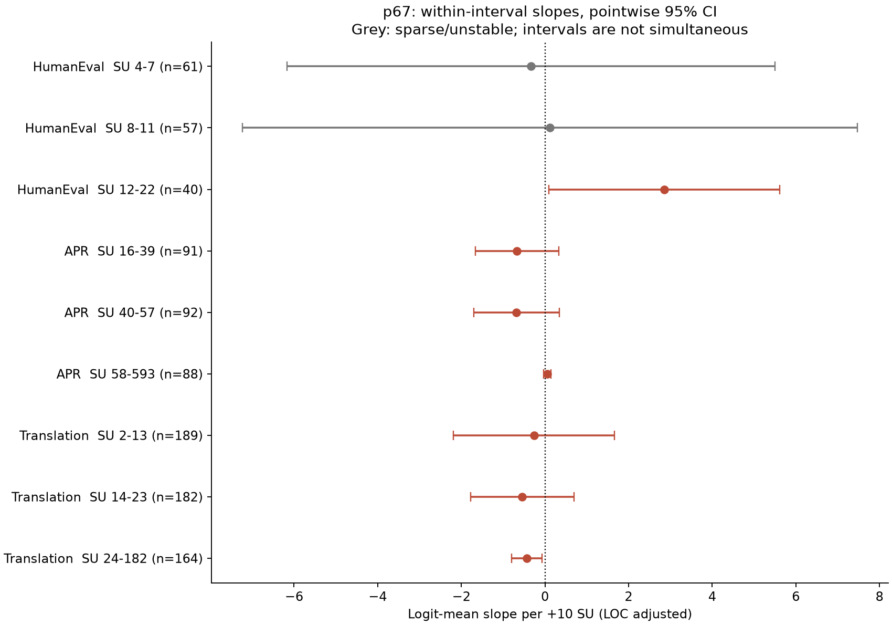

#### HumanEval


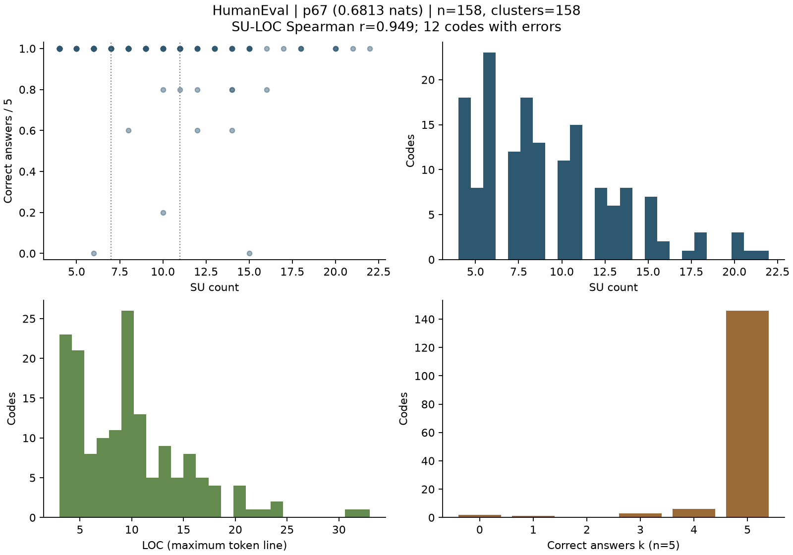

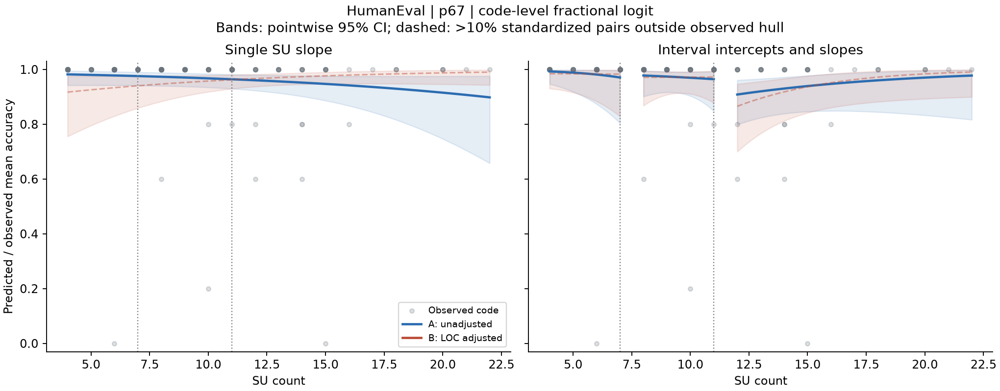

#### APR


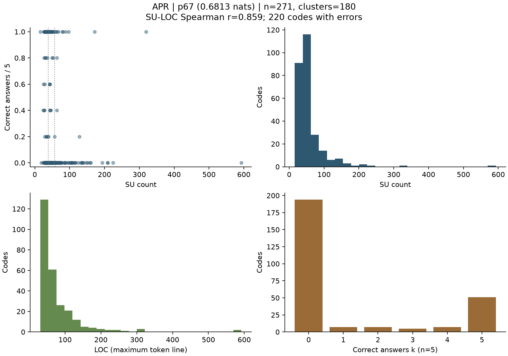

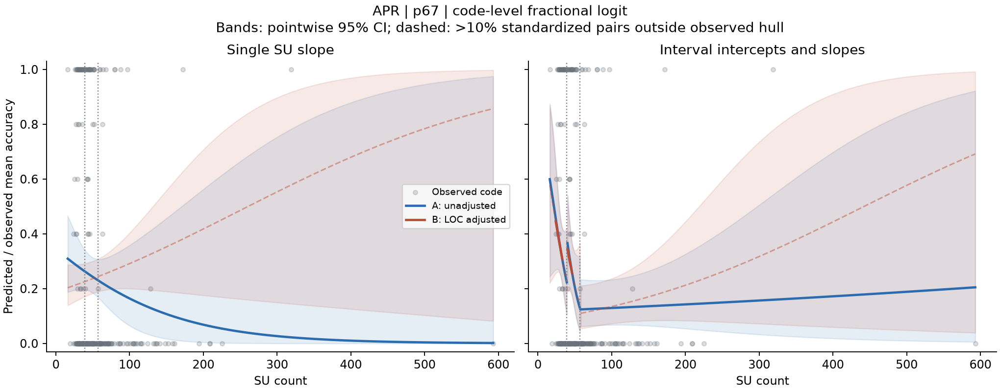

#### 翻訳


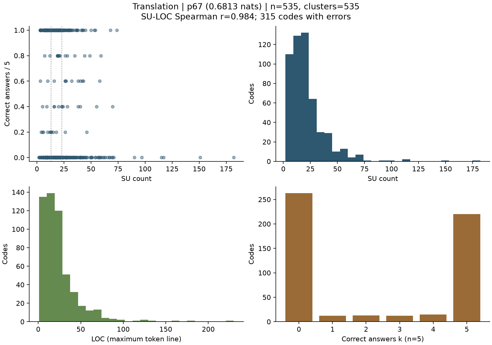

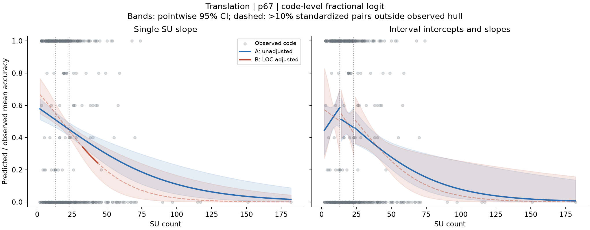

### p80の図


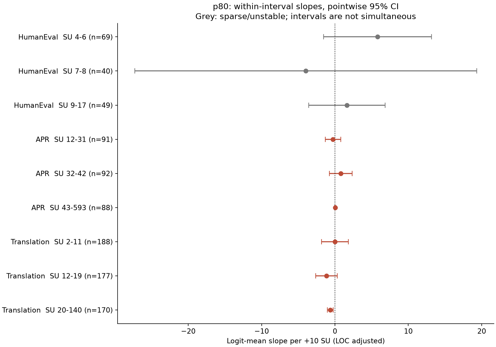

#### HumanEval


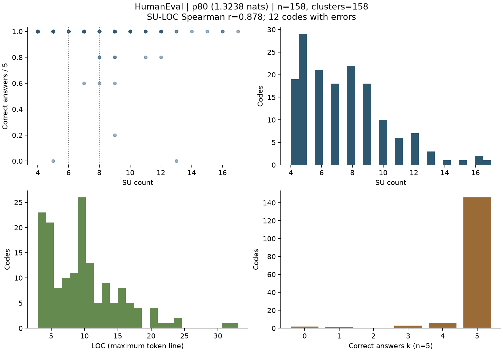

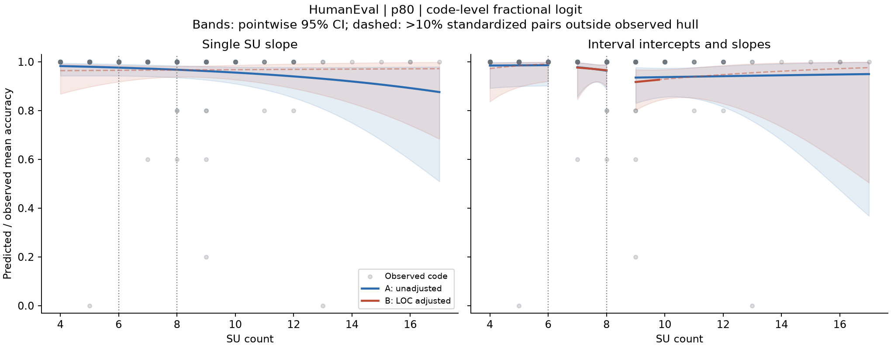

#### APR


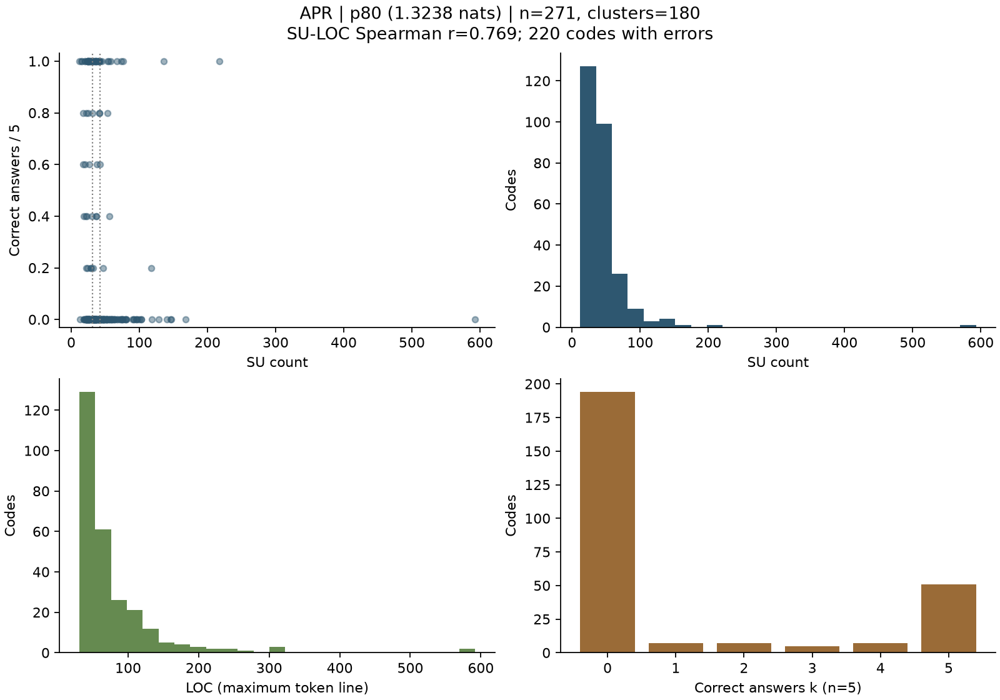

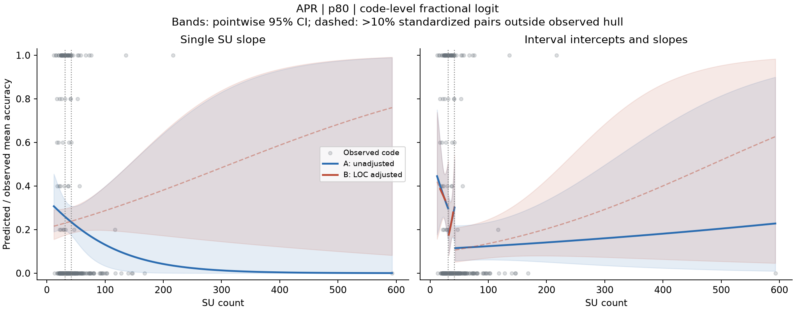

#### 翻訳


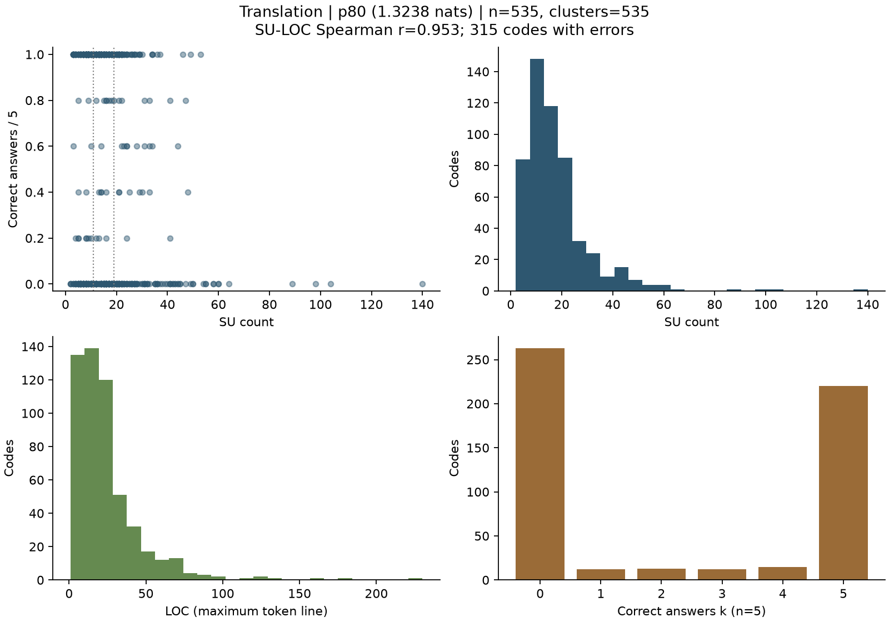

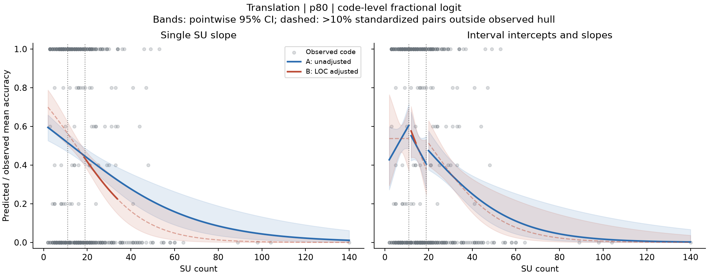


## 再現手順と計算の確認

detectの既存`.venv`を使う。以下の出力先がある場合は、未作成の名前へ変える。`prepare`が境界と設定を保存し、その後の`fit`が入力ハッシュを再確認してから回帰を実行する。

```sh
cd /Users/hyoishitobi/PycharmProjects/detect-llm-hard-to-read
PYTHONDONTWRITEBYTECODE=1 .venv/bin/python scripts/run_su_fractional_analysis.py prepare \
  --output-dir results/reanalysis/new-fractional-logit
PYTHONDONTWRITEBYTECODE=1 MPLBACKEND=Agg MPLCONFIGDIR=/tmp/codex-mpl \
  .venv/bin/python scripts/run_su_fractional_analysis.py fit \
  --run-dir results/reanalysis/new-fractional-logit
PYTHONPATH=.:src:src/analysis PYTHONDONTWRITEBYTECODE=1 MPLBACKEND=Agg \
  MPLCONFIGDIR=/tmp/codex-mpl .venv/bin/python -m unittest discover -s tests
```

テストは31件成功、0件失敗だった。うち今回の分析のテストは10件である。サンドイッチ共分散をstatsmodelsの`cov_cluster`と照合した。最大の絶対差は約4.95×10⁻¹²だった。独立にスコア方程式を解いた係数との差は約3.42×10⁻¹²だった。

24モデルの保存係数・共分散から、コードごとの予測、曲線の平均値・区間、四分位点間の差を再計算した。CSVとの一致を確認した。図はCSVに保存した値から描き、ファイルごとのSHA-256を残した。

実装確認時に「中間値の回答平均を持つ群が5未満」という自動判定を除いた。0・1の応答も回帰に情報を持つため、この条件は不適切だった。入力、区間境界、推定式、共分散、係数、信頼区間、p値、予測値は変わっていない。最初の実行を残し、数値が全件同じことを確認した。

今回使う結果は`results/reanalysis/2026-10-20-fractional-logit-reviewed/`である。先の`2026-10-20-fractional-logit/`は診断表示の修正前の記録として保持した。手順を保存したことを、既存データを使う探索から独立した確認実験へ変わった理由にはしない。

環境はPython 3.13.9、statsmodels 0.14.6、NumPy 2.4.6、pandas 3.0.3、SciPy 1.17.1である。他の描画・読み込みライブラリは`environment.json`に記録した。新しいモデルやパッケージのダウンロードはしていない。

## 保存したファイル

- `config.json`に入力ハッシュ、区間境界、モデル、補正、診断基準を保存した。
- `analysis_input.csv`にコード単位のSU、LOC、k、n、元問題ID、区間を保存した。
- `input_checks.json`、`code_identity.csv`、`exclusions.csv`に確認と除外の記録を保存した。
- `descriptive.csv`、`interval_descriptive.csv`、`count_distribution.csv`、`cluster_sizes.csv`に分布を保存した。
- `fit/coefficients.csv`に切片とLOCを含む全係数・区間を保存した。
- `fit/slopes.csv`、`interactions.csv`、`probability_contrasts.csv`に全比較を保存した。
- `fit/models/`に共分散行列と対象IDを、`fit/fitted/`にコードごとの予測を保存した。
- `fit/prediction_curves.csv`、`figure_manifest.json`、`figures/`に図の元の値と画像を保存した。
- `fit/diagnostics.json`、`unstable_or_failed_models.csv`、`leverage.csv`に不安定さと影響の記録を保存した。
- `fit/numerical_verification.json`と`implementation_review.json`に計算の照合と修正履歴を保存した。
- `scripts/`と`tests/`に再実行用コードを同梱した。元データと過去の結果は同梱せず、対象リポジトリを参照する。

## 方法の出典と既存ページ

分数応答の条件付き平均を準尤度で推定する考え方は[Papke・Wooldridgeの原典](https://www.nber.org/papers/t0147)に基づく。実装には[statsmodels GLM](https://www.statsmodels.org/stable/generated/statsmodels.genmod.generalized_linear_model.GLM.html)を使った。[群単位のサンドイッチ共分散](https://www.statsmodels.org/stable/generated/statsmodels.stats.sandwich_covariance.cov_cluster.html)とも数値を照合した。

既存の[評価方法と既存データ](https://app.notion.com/p/3f899c5c4c938121b6f9f1bb9981273f)と[検証計画](https://app.notion.com/p/3f899c5c4c93819d826bf2fa2f02fb23)から参照できる結果として整理する。コード全体の精度との関連は、局所状態の予測やSU提示の介入効果とは別の問いである。

